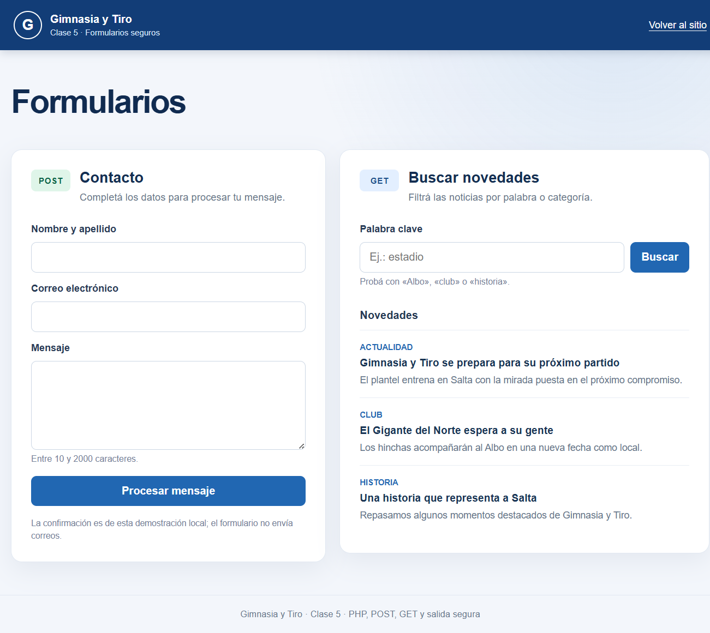
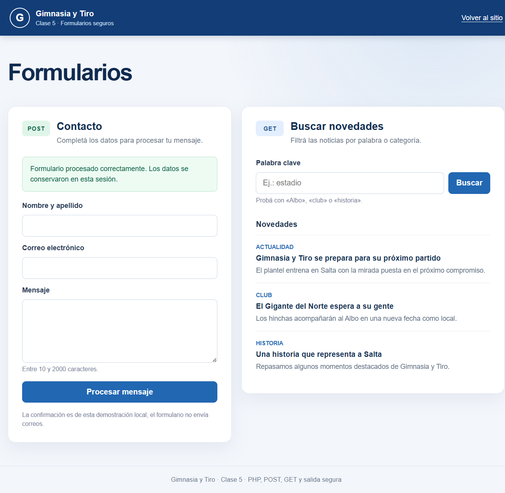
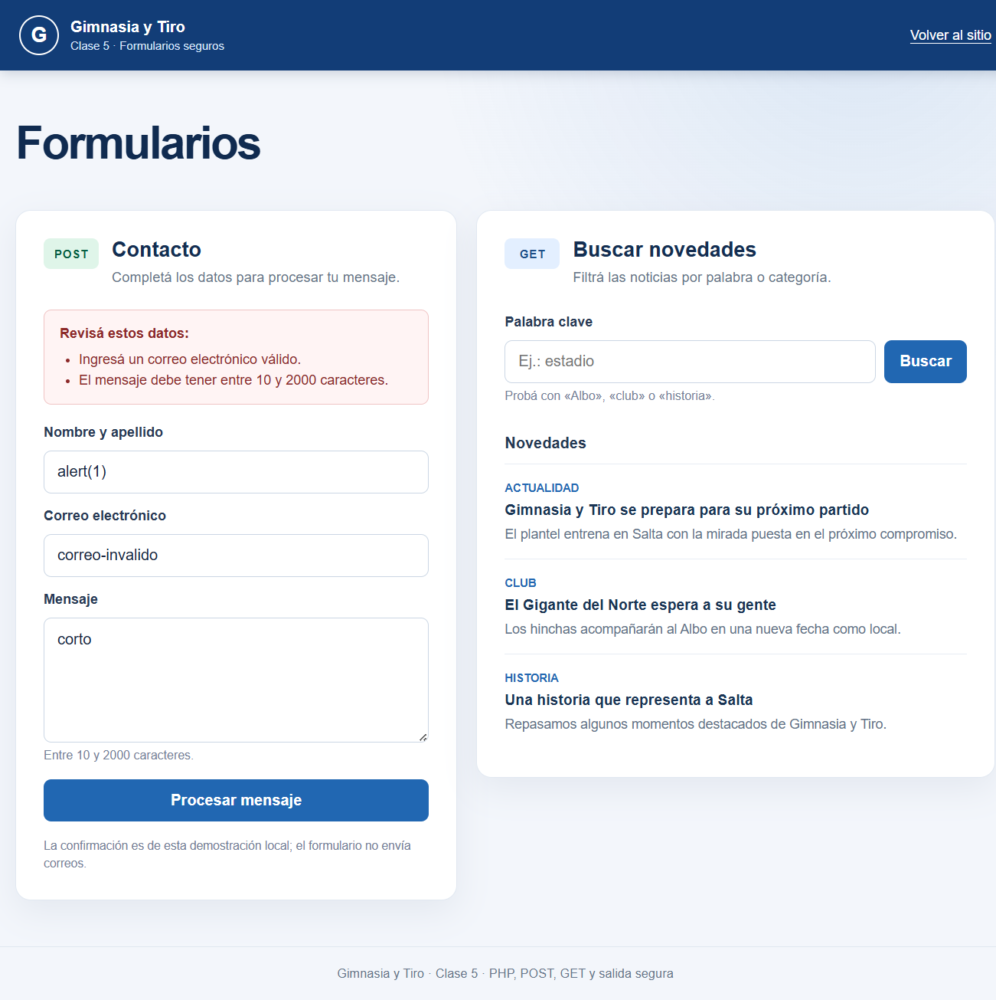
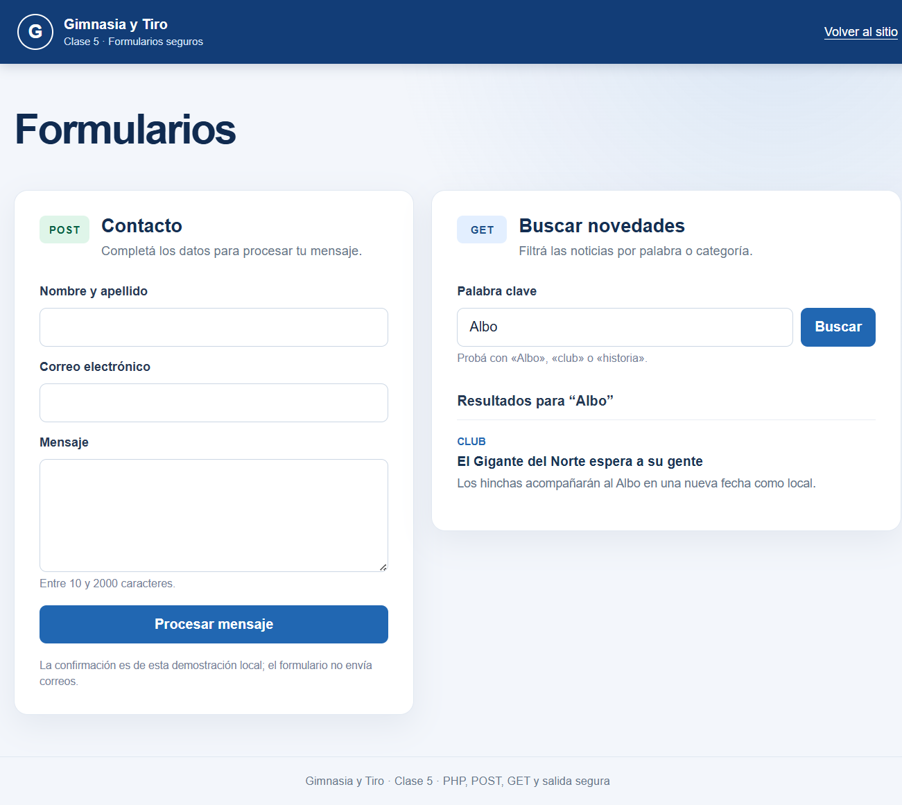
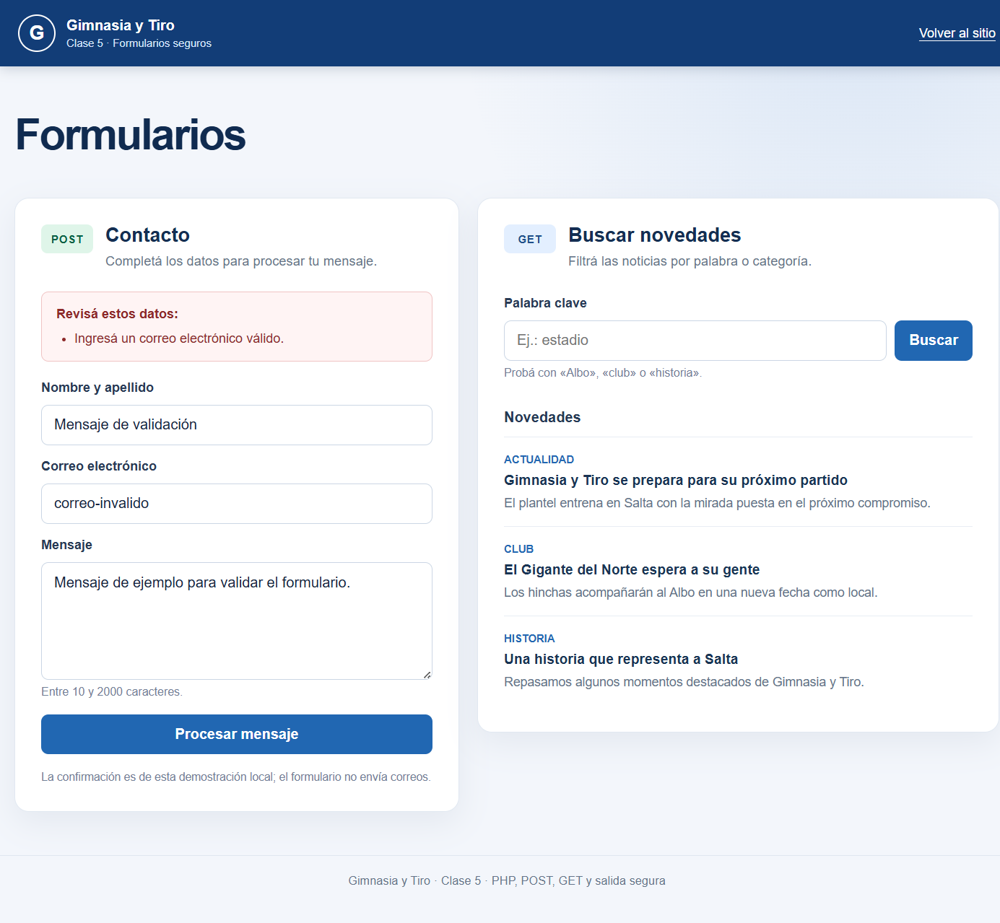
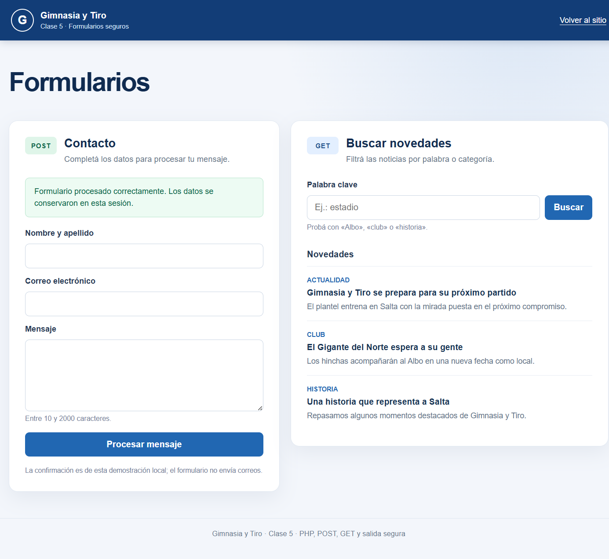

# Clase 5 — Formularios y seguridad XSS

Entrega de Gimnasia y Tiro de Salta. La carpeta `clase5` contiene la aplicación en PHP, sus estilos y las capturas de evidencia.

## Ejecutar con XAMPP

1. Copiá la carpeta `clase5` en `C:\xampp\htdocs\clase5`.
2. Iniciá Apache desde el panel de XAMPP. Esta demostración no necesita MySQL: el envío válido se conserva solo en la sesión PHP.
3. Abrí [http://localhost/clase5/](http://localhost/clase5/).

## Formularios implementados

- **POST — Contacto:** recibe nombre, correo y mensaje; valida campos obligatorios, formato del correo y longitud del mensaje. Si hay errores, muestra avisos y conserva los valores ingresados; si es válido, confirma el procesamiento.
- **GET — Búsqueda:** filtra novedades por palabra clave o categoría, valida la consulta y muestra los resultados coincidentes.
- **Validación y XSS:** los datos se validan en el servidor y se escapan con `htmlspecialchars()` antes de mostrarlos. El formulario es una demostración local: no envía correos ni almacena datos permanentemente.

## Capturas de pantalla

**Formularios POST y GET**

**Procesamiento correcto por POST**

**Validación del servidor y persistencia de campos**

**Búsqueda procesada por GET**

**Mensajes de retroalimentación**

