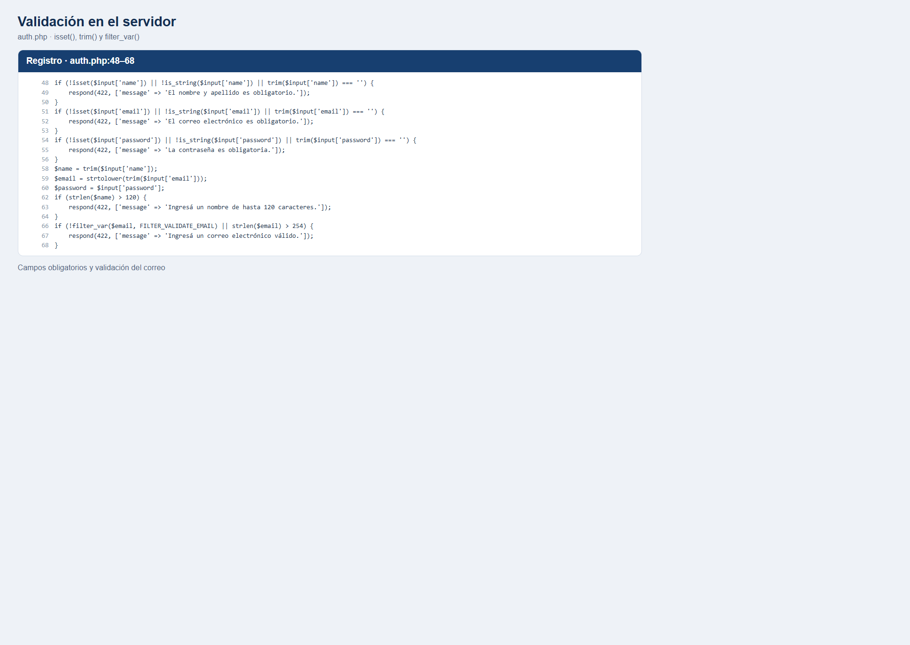
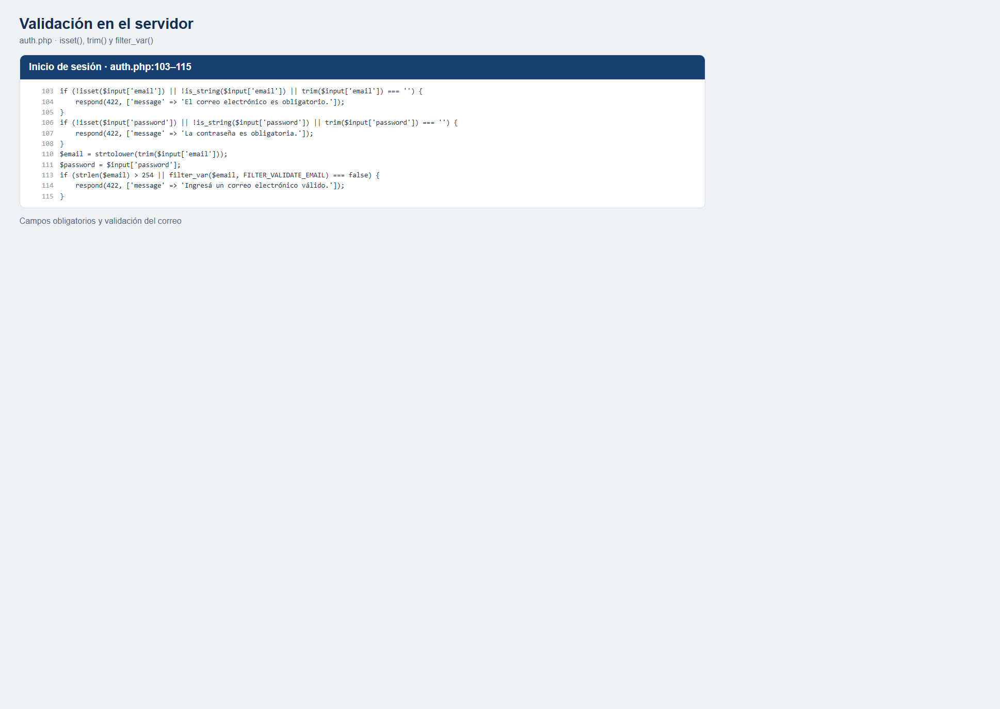
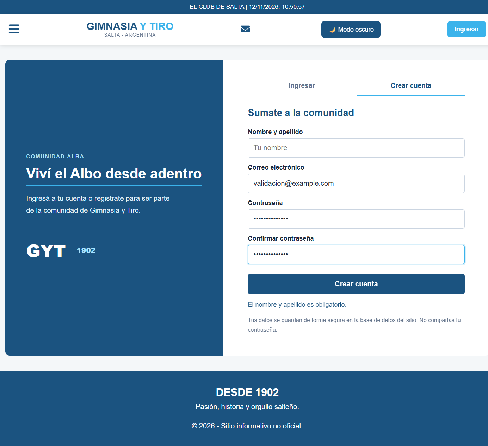
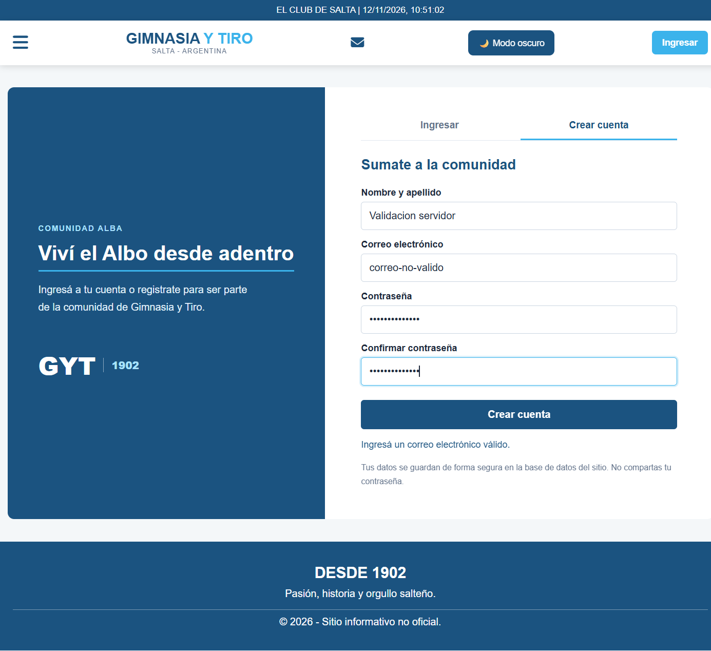
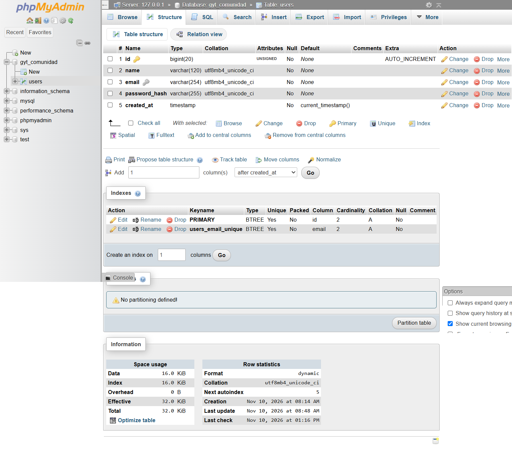
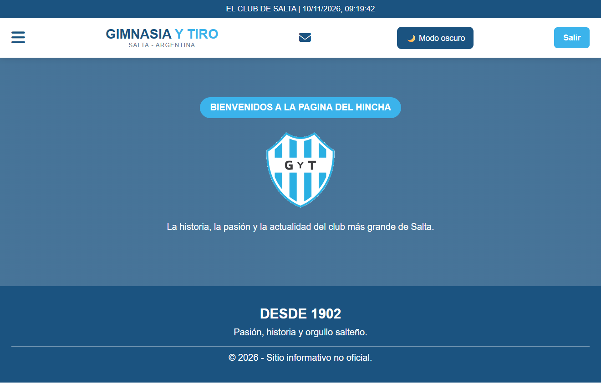

# Gimnasia y Tiro de Salta

Sitio del hincha con secciones informativas y formularios procesados en PHP.

## Ejecutar con XAMPP

1. Copiá la carpeta del proyecto a `C:\xampp\htdocs\gyt-nuevo`.
2. Iniciá Apache y MySQL desde el panel de XAMPP.
3. Para la base de usuarios, importá `database.sql` desde phpMyAdmin.
4. Abrí `http://localhost/gyt-nuevo/`.
5. La entrega de Clase 5 está en `http://localhost/gyt-nuevo/clase5/`.

## Clase 5 — Formularios y seguridad XSS

El desarrollo está dentro de la carpeta `clase5`.

- **POST — Contacto:** procesa nombre, correo y mensaje en el servidor. Valida campos obligatorios, longitud y formato del correo. Cuando hay errores, conserva los valores ingresados; si es válido, muestra una confirmación. Esta demostración conserva el último envío en la sesión PHP y no envía correos ni guarda datos permanentemente.
- **GET — Búsqueda:** filtra novedades por palabra clave o categoría, valida el largo de la consulta y conserva la búsqueda en el campo.
- **Seguridad:** los valores de entrada se normalizan y validan en PHP. Todo dato dinámico que vuelve a la página se escapa con `htmlspecialchars()` antes de mostrarse.

### Capturas de pantalla

Las capturas de la aplicación funcionando se guardan en [`clase5/capturas`](./clase5/capturas/):

**Formulario POST y búsqueda GET**

**POST procesado correctamente**

**Error de validación POST y campos conservados**

**Resultados filtrados por GET**

**Mensajes de retroalimentación al enviar el formulario**

**Validación del lado del servidor en `auth.php`**

**Ejemplos de mensajes para campos vacíos y correo inválido**

**Base de usuarios y acceso**

